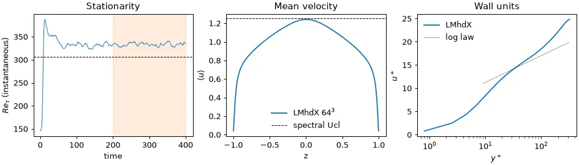

# Turbulent channel in a spanwise field (plan step H5.1)

`examples/channel_turbulence_example.py` runs the first turbulence validation case: the spanwise-field
channel of Krasnov, Zikanov and Boeck (Comput. Fluids 50, 46, 2011), Table 1. It is also the scheduled
test `tests/test_channel_turbulence.py` (marked `slow`, outside the pull-request tiers; the `turbulence`
workflow runs it weekly on the uwplasma Macs).

## Case

Plane Poiseuille flow between insulating walls at $z=\pm1$, periodic in $x$ ($L_x=2\pi$) and $y$
($L_y=\pi$), the field of Hartmann number $Ha=30$ along $y$, bulk Reynolds number $Re=6667$
(interaction parameter $Ha^2/Re=0.135$), constant bulk velocity. Mesh $64^3$ with the tanh wall grid
$z=\tanh(A\xi)/\tanh A$, $A=2$; IMEX RK3 with Crank-Nicolson viscous and damping terms, central
transport, $\Delta t=0.025$ (0.9 to 1.2 of the nominal stage-map limit, whose peak rate is a conservative sum over the axes;
0.5 at $\Delta t=0.0125$).
Times are in half-widths per bulk velocity; one time unit is $Re_\tau^2/Re\approx17$ viscous times.

The bulk velocity is held by a flux correction every 50 steps (1.25 time units): the deficit
$1-U_b$ is added as a unit-bulk profile $\propto 1-z^2$, which satisfies the walls and is
divergence-free; the body force is a constant $2\times10^{-3}$, so the drive that the run needed is the
force plus the mean correction per unit time. $Re_\tau$ is reported from the mean wall shear (a
quadratic through the wall and the two nearest cell centres) and, independently, from that mean drive;
they agree to 0.2 %. $U_{cl}$ is the mean at $z=0$ (the two central cells, averaged).

The start is the laminar profile plus low-wavenumber noise (amplitude 0.2, modes up to 4); the
instantaneous $Re_\tau$ peaks near 385 at $t=12$ and settles by $t\approx100$.

## Statistics window

Burn-in 200, then 200 time units (about 3,300 viscous times; 32 flow-throughs of $L_x$ at the bulk velocity) sampled every 1.25: 160 samples of the plane-averaged mean profile. The Re_tau trace over
the window has a standard deviation of 3.4 and a block-mean standard error of 0.7 (0.2 %); the first
and second half give 333.6 and 333.2. The paper does not state its averaging time.

## Result and cost

| | $Re_\tau$ | $U_{cl}$ |
|---|---|---|
| spectral, 256³ (KZB 2011) | 306.69 | 1.2542 |
| scheme B 64³ / 128³ / 256³ (KZB 2011) | 306.99 / 306.45 / 304.72 | 1.2459 / 1.2532 / 1.2575 |
| LMhdX 64³, $\Delta t=0.025$ | 333.4 (+8.7 %) | 1.2415 (−1.0 %) |
| LMhdX 64³, $\Delta t=0.0125$, 100 time units | 334.7 (+9.1 %) | 1.2431 (−0.9 %) |

$U_{cl}$ is within the plan's 1.5 % but just below the finite-difference spread; $Re_\tau$ is **not**
within the plan's 2 %: it is 8.7 % high, far outside both the statistical error and the time-step
effect. The probable cause is the scheme, not the run: the staggered central scheme conserves kinetic
energy and adds no numerical dissipation, and at $\Delta x^+\approx33$, $\Delta y^+\approx16$ the
unresolved scales are not drained, so the friction is higher; the paper's scheme B is dissipative at
$O(\Delta t\,\Delta x^2)$ and lands on the spectral value at this resolution. The resolution study below tests that reading.

Cost on one Mac (14 cores, shared, load average 40 to 100 during the run, float64, one XLA CPU
process): 0.29 s per step at $\Delta t=0.025$ (16,000 steps, 1 h 18 min of the stepping for 400 time
units); 0.22 s per step at $\Delta t=0.0125$, which restarted from the $t=200$ state with 25 time units of burn-in. The plan's estimate of "minutes to hours" holds; the
128³ case is about 8 times the cells and twice the steps, about 20 hours at the same speed, and stays
a GPU run.

## Resolution study

The same example with only `CELLS` and `OUTPUT_DIR` changed, on a GPU workstation (RTX A4000, float64,
$\Delta t=0.025$, burn-in 200, window 200, 8,000 steps, one realization, seed 1). The error is against the
spectral $Re_\tau$ = 306.69 and $U_{cl}$ = 1.2542. The block standard error is that of five contiguous 40-unit
blocks of the instantaneous $Re_\tau$ in the window; the blocks are correlated, so it is if anything optimistic.

| cells | $Re_\tau$ (wall shear) | error | $Re_\tau$ (mean drive) | $U_{cl}$ | error | block SE | $\Delta x^+$ | $\Delta y^+$ | first $z^+$ | s per step |
|---|---|---|---|---|---|---|---|---|---|---|
| $64^3$ | 334.40 | +9.03 % | 333.83 | 1.2491 | −0.41 % | 0.79 | 32.8 | 16.4 | 0.81 | 0.135 |
| $96^3$ | 325.94 | +6.28 % | 325.74 | 1.2478 | −0.51 % | 1.14 | 21.3 | 10.7 | 0.52 | 0.589 |
| $128^3$ | 316.38 | +3.16 % | 316.26 | 1.2541 | −0.01 % | 1.52 | 15.5 | 7.8 | 0.37 | 1.547 |

Wall units use each run's own $Re_\tau$; the first $z^+$ is the first cell centre. Timings are from clean
500-step runs on an idle card; the $128^3$ run took 6.05 h for 400 time units.

$Re_\tau$ falls monotonically toward the spectral value as $\Delta x^+$ and $\Delta y^+$ shrink, while the first cell
stays below $z^+=1$ on every grid, so the wall layer is not what moves it. This is consistent with the central
scheme reading above. The local order is noisy (about 0.9 between $64^3$ and $96^3$, 2.4 between $96^3$ and $128^3$), so the
data do not fix the order of convergence; $U_{cl}$ is within its gate on every grid. A second-order extrapolation
from $96^3$ and $128^3$ lands near the spectral value, with an uncertainty of a few units of $Re_\tau$ that the order
ambiguity alone sets. At $128^3$ the miss, +3.2 %, is about six block standard errors, so it is not a statistical
fluctuation.

The scheduled test gates $U_{cl}$ (1.5 %), the regime and the shear/drive agreement, and carries the
plan's 2 % $Re_\tau$ gate as a strict expected failure, so that the day the number moves into it the
test says so.
